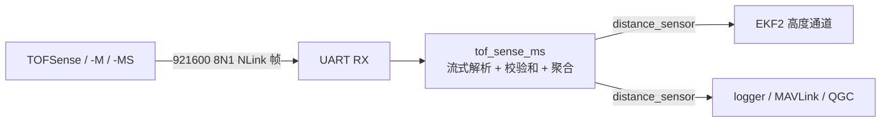

# tof_sense_ms — Nooploop TOFSense / -M / -MS 串口测距驱动

PX4 串口驱动，读取 Nooploop（空循环）TOFSense 系列激光测距模块的 **NLink** 数据帧，
校验后把（面阵型号聚合成的）单点距离发布到 uORB `distance_sensor`，供 EKF2 做高度融合/参考。



| 项 | 值 |
|---|---|
| 模块名 | `tof_sense_ms` |
| Kconfig | `CONFIG_DRIVERS_DISTANCE_SENSOR_TOF_SENSE_MS` |
| 设备类型 | `DRV_DIST_DEVTYPE_TOFMS` (0x9D)，`distance_sensor` 的 `orientation` 默认 25（下视） |
| 输出 | `distance_sensor`（type = LASER，10 Hz 跟随传感器上报） |
| 依赖 | `drivers_rangefinder`（`PX4Rangefinder`） |
| 支持平台 | NuttX（飞控）与 POSIX（SITL） |

---

## 1. 支持的型号

| 型号 | 帧类型 | 每帧长度 | 说明 |
|---|---|---|---|
| TOFSense、TOFSense-F、TOFSense-S | 单点（功能字 `0x00`） | 16 字节 | 直接输出一个距离 |
| **TOFSense-M / MS** | 面阵（功能字 `0x01`） | **400 字节**（8×8=64 区） | 每区 6 字节；4×4=16 区时帧更短 |

驱动**自动识别**两种帧，不需要配置型号。面阵型号会按第 5 节聚合成一个距离。

> 为什么需要这个驱动：PX4 主线里没有 NLink/TOFSense 驱动（`src/drivers/distance_sensor/`
> 只有 tfmini / lightware / teraranger 等），TOFSense-M 的 400 字节面阵帧格式也没有现成解析。

---

## 2. 协议（NLink）

默认 **921600 8N1**，模块主动上报，小端。校验和 = 前面所有字节之和取低 8 位。

### 2.1 单点系列（16 字节）

| 偏移 | 长度 | 字段 | 说明 |
|---|---|---|---|
| 0 | 1 | `0x57` | 帧头 |
| 1 | 1 | `0x00` | 功能字（单点） |
| 2 | 1 | `0xFF` | 固定 |
| 3 | 1 | id | 模块 ID |
| 4 | 4 | system_time | 上电后毫秒 |
| 8 | 3 | distance | **有符号 24 位，单位 mm**（可为负） |
| 11 | 1 | dis_status | 0 = 有效 |
| 12 | 2 | signal_strength | 信号强度 |
| 14 | 1 | range_precision | 精度（预留） |
| 15 | 1 | checksum | 校验和 |

### 2.2 面阵系列 M / MS（400 字节，8×8）

| 偏移 | 长度 | 字段 | 说明 |
|---|---|---|---|
| 0 | 1 | `0x57` | 帧头 |
| 1 | 1 | `0x01` | 功能字（面阵） |
| 2 | 1 | `0xFF` | 固定 |
| 3 | 1 | id | 模块 ID |
| 4 | 4 | system_time | 上电后毫秒 |
| 8 | 1 | zone_map | 区数：64（8×8）或 16（4×4） |
| 9+6·i | 3 | 第 i 区 distance | **无符号 24 位，单位 µm**（492000 = 492 mm） |
| 12+6·i | 1 | 第 i 区 dis_status | 0 = 有效，0xFF = 无效 |
| 13+6·i | 2 | 第 i 区 signal | 信号强度 |
| … | 6 | 尾部填充 | 8×8 模式下全是 `0xFF` |
| 399 | 1 | checksum | 校验和 |

解析器在 **394 与 400 两个长度**上都验校验和，因此对「有/无 6 字节尾部」两种固件都兼容，
4×4 模式（16 区）也能直接解析。

### 2.3 查询模式（模块配成被动上报时）

发送 8 字节：`57 10 FF FF <id> FF FF <checksum>`。驱动默认只接收，不发送。

参考：[Nooploop 协议文档](https://support.nooploop.com/tofsense/protocol/)、[例程](https://support.nooploop.com/tofsense/example-code/)。

---

## 3. 代码结构

```
tof_sense_ms/
├── Kconfig                   CONFIG_DRIVERS_DISTANCE_SENSOR_TOF_SENSE_MS
├── CMakeLists.txt            px4_add_module(drivers__tof_sense_ms)
├── module.yaml               模块名（PX4 元数据/参数生成）
├── tof_sense_ms_parser.h     纯 C++ 帧解析器（不依赖 PX4，可在 PC 上单测）
├── tof_sense_ms_parser.cpp    状态机：Sync → Function → Header → Payload
├── TOFSenseMS.hpp            驱动类（Serial + ScheduledWorkItem）
├── TOFSenseMS.cpp            串口配置、4 ms 轮询、聚合、发布 distance_sensor
└── tof_sense_ms_main.cpp     start / stop / status 命令行
```

数据流：`read()` 原始字节 → `Parser::push()` 逐字节喂入 → 校验和通过的 `Frame`
→ `aggregate()` 合成单点距离 → `PX4Rangefinder::update()` 发布 `distance_sensor`。

设计要点：

- **解析与驱动分离**：parser 不含任何 PX4 头文件，可以在 PC 上编译跑单元测试（见第 10 节）；
- **流式、容错**：不需要整帧对齐，任意位置丢字节都能在下一帧重新同步；校验失败的帧整帧丢弃并计数；
- **无阻塞**：fd 设为 `O_NONBLOCK`，4 ms 周期最多读 16 次 × 128 字节，读空即返回；
- **无效区过滤**：先按 `dis_status == 0` 和量程过滤，再做聚合，避免把 `0xFFFFFF` 这类无效值算进平均。

---

## 4. 编译与启用

板级 `default.px4board` 里打开：

```
CONFIG_DRIVERS_DISTANCE_SENSOR_TOF_SENSE_MS=y
```

其他板子也可以临时打开 `CONFIG_COMMON_DISTANCE_SENSOR`，或直接把这一行加进自己的 board 配置。

SITL（POSIX）同样可用：本仓库的 `boards/px4/sitl/tof.px4board` 就是为此加的 SITL 目标，
`make px4_sitl_tof` 后可用虚拟串口（pty）喂帧，无需硬件即可调驱动。

---

## 5. 命令行

```
tof_sense_ms start [-d <dev>] [-b <baud>] [-a <mode>] [-R <rotation>] [-m <min>] [-M <max>]
tof_sense_ms status
tof_sense_ms stop
```

| 参数 | 默认 | 说明 |
|---|---|---|
| `-d` | `/dev/ttyS1` | 串口设备 |
| `-b` | `921600` | 波特率（9600 … 3000000） |
| `-a` | `0` | 面阵聚合方式：`0` 中心区均值（推荐）、`1` 全图中位数、`2` 全图均值 |
| `-R` | `25` | 安装方向（`25` = 下视 `ROTATION_DOWNWARD_FACING`） |
| `-m` | `0.02` | 最小距离 [m]（写进 `distance_sensor.min_distance`，同时作为过滤下限） |
| `-M` | `4.0` | 最大距离 [m] |

示例：

```sh
# 开机脚本里（本仓库 MoonPilot 板就是这么写的）
tof_sense_ms start -d /dev/ttyS1 -b 921600 -a 0

# 换成六芯 GPS 口（UART4）上的全双工串口
tof_sense_ms start -d /dev/ttyS3 -b 921600

# 看状态
tof_sense_ms status
```

`status` 输出示例：

```
INFO  [tof_sense_ms] port: /dev/ttyS1, baud: 921600, aggregation: center
INFO  [tof_sense_ms] frames: 547, frame rate: 10 Hz, parser errors: 0 (checksum: 0)
INFO  [tof_sense_ms] last frame: type 1, zones 64, distance 2.501 m
tof_sense_ms: read: 11741 events, 0us elapsed ...   ← perf 计数
tof_sense_ms: com_err: 0 events                     ← 串口读错误
tof_sense_ms: invalid: 0 events                     ← 有帧但无有效区（被遮挡/超量程）
```

排障时重点看三个数：`frame rate`（应≈模块上报频率）、`parser errors`（应 0）、`invalid`（遮挡时才会涨）。

### 5.1 端口选择：`TOFMS_CFG`（QGC 可改）

MoonPilot 板把"驱动跑在哪个串口"做成了参数，在 QGC → 参数 → `Sensors` 里改，**重启生效**：

| 值 | 端口 | 说明 |
|---|---|---|
| 0 | — | 不启动驱动 |
| **1** | `/dev/ttyS1`（UART2 RX，PD6，U11 第 6 脚） | **默认**，只收不发 |
| 2 | `/dev/ttyS3`（UART4，PB9/PB8，U11 第 3/4 脚） | 六芯口；若同一口还接 GPS 会冲突 |

参数由 `module.yaml` 定义，实际分支在**板级启动脚本**里（`boards/moonpilot/tof/init/rc.board_sensors`）：

```sh
if param compare TOFMS_CFG 1
then
	tof_sense_ms start -d /dev/ttyS1 -b 921600 -a 0
fi
if param compare TOFMS_CFG 2
then
	tof_sense_ms start -d /dev/ttyS3 -b 921600 -a 0
fi
```

两个要点：

- **驱动自身不读这个参数**，是脚本读的。移植到别的板子时，照抄这两段 `if param compare` 即可，
  想加第三个端口就再加一段（不需要改驱动、不需要重编驱动）。
- 为什么不用 PX4 标准的 `SENS_*_CFG`（`serial_config`）：那套的下拉框选项只能来自板级
  `CONFIG_BOARD_SERIAL_*` 声明；本板的 UART2（`ttyS1`）不在标准列表里，硬塞成 `TEL1`
  会让 MAVLink 遥测和 TOF 抢同一个 tty。自定义参数没有这个限制。

不想重启就临时切（重启后回到参数值）：

```sh
tof_sense_ms stop
tof_sense_ms start -d /dev/ttyS3 -b 921600
```

---

## 6. 面阵 → 单点：聚合算法

8×8 的 64 个区不能直接塞给 EKF，驱动按 `-a` 合成一个距离：

| 模式 | 做法 | 适用 |
|---|---|---|
| `0` 中心区（默认） | 取**中间 4×4 区**的均值（4×4 模式取中间 2×2）；中心全无效时退回全图中位数 | 定高：只关心机身正下方 |
| `1` 中位数 | 全部有效区的中位数 | 地面不平、有零星干扰 |
| `2` 均值 | 全部有效区的均值 | 地面平整、想要最平滑 |

细节：

- 有效区判定：`status == 0` **且** `min ≤ d ≤ max`；
- `signal_quality`：取所用区信号强度的均值，钳到 0…100；
- **一个有效区都没有时不发布消息**（让 EKF 自然超时），并累加 `invalid` 计数——
  比发布一个假距离安全；
- 帧率、聚合模式变了都不需要重启（`-a` 除外）。

---

## 7. 与 EKF2 的配合（重要）

`distance_sensor` 只是"一个测距"，要不要用、怎么用由 EKF2 参数决定：

| 参数 | 建议 | 说明 |
|---|---|---|
| `EKF2_RNG_CTRL` | `1` | 1 = 持续融合测距；**必须为 1 才会用** |
| `EKF2_HGT_REF` | `1`（GPS）或 `0`（气压计） | 高度**参考源**。设成 `2`（测距）会让高度估计对齐测距 |
| `EKF2_BARO_CTRL` | 保持 `1` | **不要关** |

**实测结论（SITL 闭环，细节见仓库 `SIM_RESULTS.md`）**：

- 常规配置（气压计 + GPS + 测距辅助）：定高 2.52 m ± 1 cm，测距与真值差 ≤ 32 mm；
- 把测距设为高度参考并注入 +0.5 m 偏差：EKF 高度估计变成 0.53 m 而真实高度仍是 0
  → 证明测距**确实**是 EKF 的高度参考，不只是"被发布"；
- **把气压计和 GPS 高度都关掉、只留测距 → 起飞被拒**
  （`Preflight Fail: height estimate not stable`）。这是 EKF2 的设计约束：测距有最小量程、无绝对基准，
  不能作为垂直状态的启动源。所以「只靠一颗 TOF 定高」不可行，必须保留气压计或 GPS 高度。

推荐用法：**测距做辅助/近地精化**（默认）；室内需要更准的定高时把 `EKF2_HGT_REF` 设为 `2`，
但气压计必须保持开启。

---

## 8. 接线（MoonPilot 板为例）

| 用途 | MCU 引脚 | 板上位置 | NuttX 设备 |
|---|---|---|---|
| **TOF（默认）** | PD6 = UART2_RX | U11 第 6 脚 | `/dev/ttyS1` |
| TOF（备选，全双工） | PB9/PB8 = UART4_TX/RX | U11 第 3/4 脚 | `/dev/ttyS3` |

TOFSense 只发不收，所以默认挂在只引出 RX 的 UART2 上，把 UART4 留给 GPS。
接线：传感器 TX → 飞控 RX，共地，5V 供电（模块峰值电流较大，建议独立 5V 或加大电容）。

---

## 9. 排障

| 症状 | 可能原因 | 处理 |
|---|---|---|
| `frame rate 0`、`frames` 不涨 | 波特率不对 / 接反（TX-TX）/ 没共地 | 确认模块波特率（出厂 921600）；试 `-b 115200` |
| `parser errors` 持续涨 | 波特率偏差大、线太长、电平不匹配 | 降波特率；检查线材与地 |
| `checksum` 涨但 `frames` 也涨 | 偶发干扰 | 一般无需处理，关注比例 |
| `invalid` 持续涨 | 全部区无效：贴太近（<2 cm）、超量程、黑面/斜面反射弱 | 检查安装高度与目标面 |
| `frames` 正常但 `listener distance_sensor` 没数据 | 驱动没启动 / 实例被别的测距占用 | `tof_sense_ms status`；`listener distance_sensor` 看 instance |
| EKF 不采纳 | `EKF2_RNG_CTRL=0`，或 EKF 判定与气压计不一致 | 设 `EKF2_RNG_CTRL=1`；看 `estimator_status` 的 `CS_RNG_FAULT` |

---

## 10. 测试

**解析器单元测试**（PC 上跑，不依赖 PX4，含厂商文档里的真实 400 字节样帧）：

```sh
cd <repo>/px4_moonpilot_tof/tools
python3 gen_sample_frame.py          # 抓一次厂商参考帧（生成 tof_sample_frame.h）
g++ -std=c++17 -O1 -Wall -Wextra -o test_parser test_parser.cpp \
    ../drivers/tof_sense_ms/tof_sense_ms_parser.cpp -I.
./test_parser                        # 34 checks, 0 failures
```

**SITL 闭环测试**（虚拟串口喂帧 + SIH 物理模型 + EKF2 + 控制器）：
见 `px4_moonpilot_tof/SIM_RESULTS.md`，其中包含 6 组测试的数据表。

---

## 11. 已知限制 / 可扩展点

- 4×4 模式（16 区）解析器兼容但**未实测**（手上只有 8×8 样帧）；
- 只实现接收，不实现查询模式（`57 10 …`）与参数配置（用厂商 NAssistant 配模块）；
- CAN 接口的 TOFSense 未支持（走 UAVCAN 需另行实现）；
- 单点系列的 `signal_strength` 量纲与面阵不同，`signal_quality` 只是粗略映射（0–100）；
- 面阵聚合用的是简单统计（中心均值/中位数），没有做平面拟合或倾斜补偿。

---

## 12. 换板子/换版本怎么移植

见项目根目录的 **[PORTING.md](../../../../PORTING.md)**（四种场景 + 检查表 + 常见报错对照）。

---

## 13. 许可

BSD-3-Clause，与 PX4 一致。
